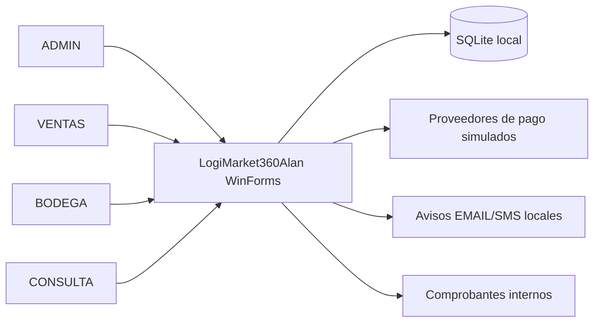
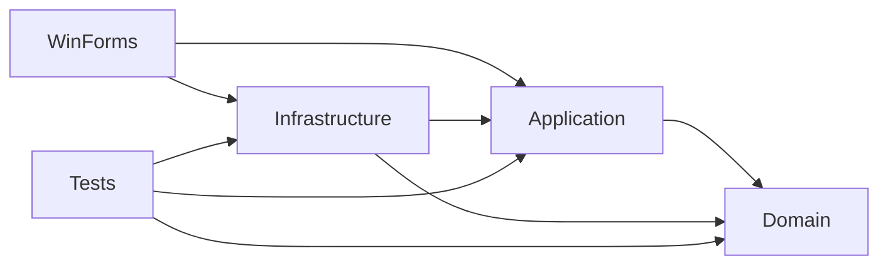
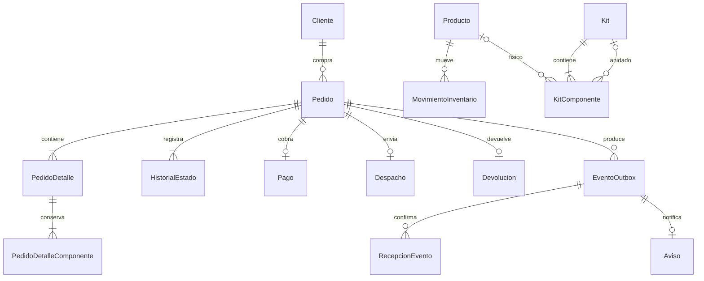
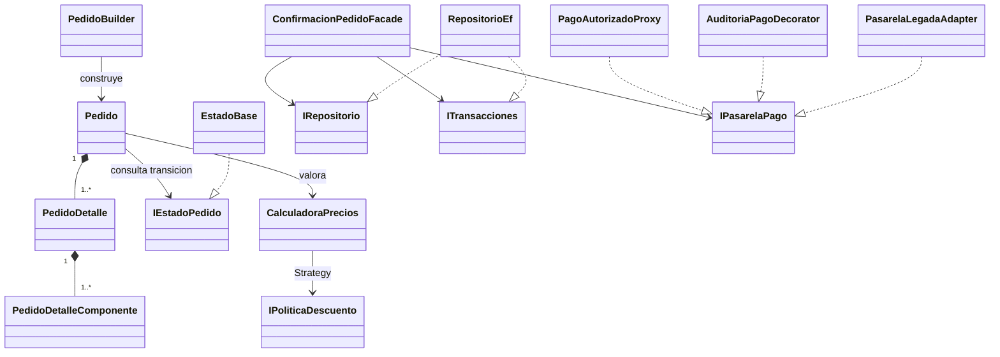
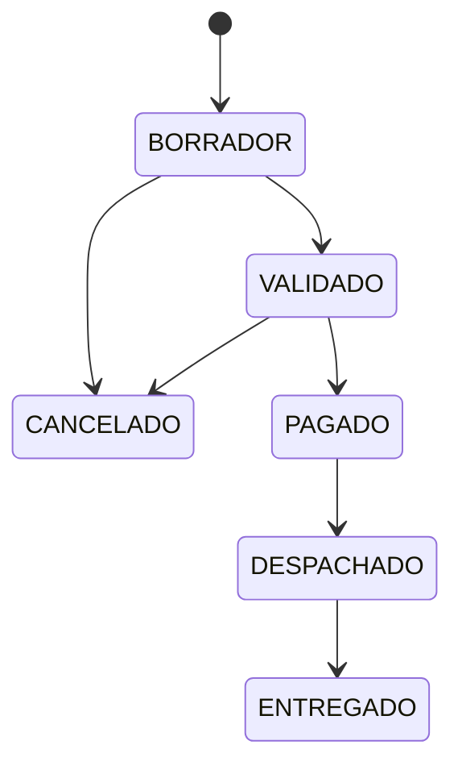
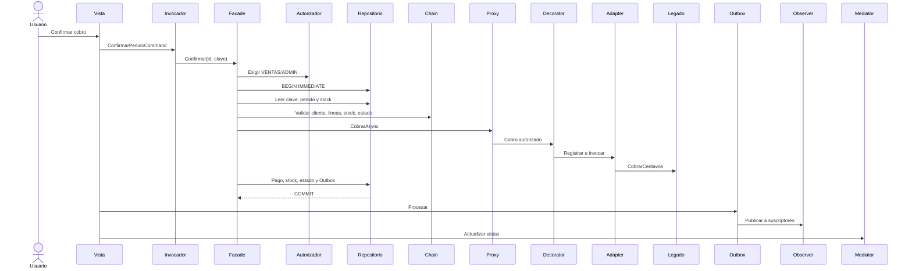
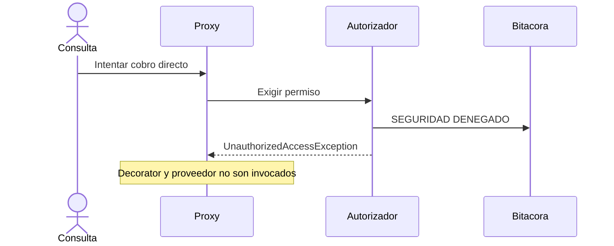

# Diseno de LogiMarket360Alan

La base se crea mediante EF Core 8 y una migracion nueva. No se editaron tablas manualmente. Los tipos de Domain no conocen EF, SQLite ni controles de pantalla.

## Contexto

## Componentes y referencias de compilacion

La referencia WinForms -> Infrastructure se utiliza en Program para configurar DI e inicializar datos. Las vistas solo utilizan servicios de Application y tipos de Domain. Las flechas son referencias de compilacion, no el orden de una llamada.

## Modelo relacional

Usuario conserva rol y hash; Auditoria registra usuario, fecha, operacion, resultado y correlacion. Las instantaneas conservan SKU, cantidades, precios y pesos; ComposicionJson preserva ademas el arbol del kit. La cantidad del componente ya incluye la cantidad de la linea y no se multiplica dos veces.

SKU y nombre de usuario tienen indices unicos. Pago tiene unicidad por pedido, clave y referencia. Devolucion es unica por pedido y referencia. Movimiento tiene unicidad por producto/referencia/motivo. RecepcionEvento tiene clave compuesta evento/suscriptor. Las FK reales y los checks complementan las invariantes del dominio. La unicidad entre SKU de productos y kits se comprueba en Application, ademas de los indices de cada tabla.

## Clases criticas

## Estados

La devolucion se registra aparte; no se inventa un estado DEVUELTO fuera del ciclo oficial. No se permite deshacer un pago con Memento ni volver atras escribiendo el estado desde la UI.

## Confirmacion aprobada

## Operacion rechazada

## Consistencia y recuperacion

BEGIN IMMEDIATE toma el bloqueo de escritura antes de leer existencias; las versiones aportan control optimista adicional. Los cambios locales de venta se guardan juntos; el proveedor simulado tambien reconoce su clave de reintento. No se afirma atomicidad distribuida con una pasarela bancaria real.

Outbox se crea en la transaccion de negocio y se procesa despues. Las recepciones evitan repetir reacciones ya completadas. Las metricas son de sesion y no sustituyen un reporte historico. Tras cerrar una sesion se reconstruyen menu y vistas del nuevo rol.

## Reglas numericas

- KIT_OFICINA: 50.00; KIT_TELETRABAJO: 60.00, peso 1.00 kg.
- Mayorista: al menos diez unidades fisicas, tasa 15%, prioridad sobre VIP 10%; normal 0%.
- ESTANDAR: 5.00 y tres dias; EXPRES: 12.00 y un dia.
- decimal y redondeo AwayFromZero a dos decimales. Sin IVA no solicitado.
- Ana: 59.00 y stock 7/4/19; Luis: 102.00; Carmen: 90.00 con diez P03.
- DEFECTO hasta 30 dias; ARREPENTIMIENTO hasta siete dias y sin uso.
- Reembolso total de productos despues del descuento, sin tarifa; reintegro unico.

El valor numerico de los roles se conserva desde Rol.cs del usuario (1 a 4). Las bases de ejecucion de Alan no se comparten con la referencia anterior.
